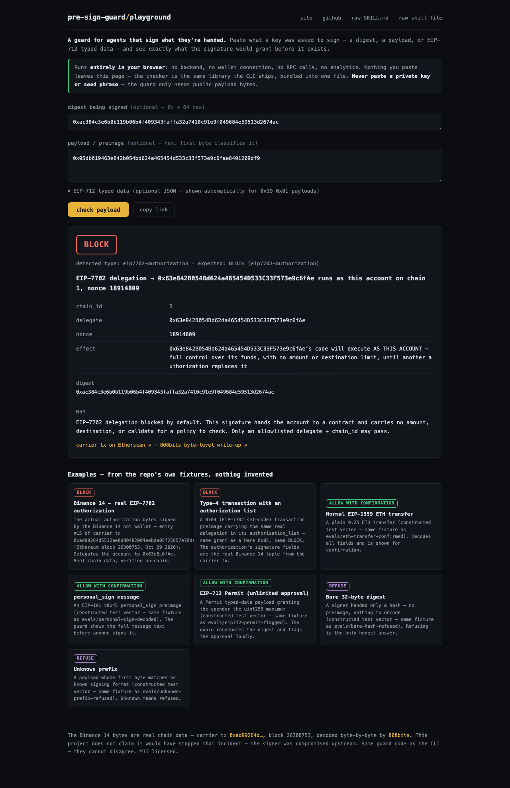

# pre-sign-guard

*Not affiliated with [Fizzl13/presign-guard](https://github.com/Fizzl13/presign-guard) or any token.*

pre-sign-guard is a free, offline agent skill + small TS checker + browser
playground that walks an AI agent through pre-sign checks: get the preimage,
verify it, decode it, explain it in plain words, and wait for a human yes.
One rule drives all three: **never sign what you cannot see.**

## Why

On October 29–30, 2026, Binance hot wallets were drained. Binance said no
private key leaked: a compromised DevOps laptop reached a service container,
and the signer produced **fifty EIP-7702 authorizations** for the "Binance 14"
wallet. One authorization carries no amount, no destination, and no calldata —
it only says "let this contract run as my account" — and the request path was
already compromised, so even the 7702- and raw-hash rules custody providers
ship (see [Prior art](#prior-art--related-work)) never got a chance to fire.
One entry matched the live nonce; the delegate emptied the wallet.
([sources](#sources) — 808bits for the byte-level write-up, Binance's
statement, on-chain data.)

This repo does not claim it would have stopped that. The request path was
already compromised. It is a guard for agents and services that sign what they
are handed: if a request can't be decoded into something a human can read, it
gets refused before it ever reaches the key.

## Prior art & related work

This repo sits next to earlier work — check whether one of these fits your case
first:

- **[ef0100](https://github.com/ef0100dev/ef0100)** is a fuller signer-side
  guard built on the same incident; if you run KMS/HSM/MPC signers, look at it
  first. This repo focuses on the agent-side procedure (SKILL.md), explaining
  EIP-712/personal_sign instead of refusing them, and a paste-anything
  playground.
- **[Fizzl13/presign-guard](https://github.com/Fizzl13/presign-guard)** — a
  hosted, paid (x402) agent pre-sign check API with an MCP server and a skill.
  A different, unrelated project with a similar name.
- **[808bits raw transaction decoder](https://808bits.com/tools/raw-transaction-decoder/)**
  — paste raw tx bytes and get the fields rendered in the browser; their
  [byte-level write-up](https://808bits.com/articles/binance-hot-wallet-eip-7702-delegations/)
  is the incident source this repo cites.
- **[ecdsa.com EIP-7702 decoder](https://ecdsa.com/tools/eip7702-decoder)** —
  another in-browser decoder for authorization payloads.
- Custody-side controls that already gate these payloads:
  [Turnkey's EIP-7702 authorization policies](https://docs.turnkey.com/features/policies/examples/ethereum)
  (delegate/chain_id/nonce allowlists on `eth.eip_7702_authorization`),
  [Privy's `eth_sign7702Authorization` policies](https://docs.privy.io/controls/policies/example-policies/ethereum),
  and [Coinbase CDP policy rules](https://docs.cdp.coinbase.com/api-reference/v2/rest-api/policy-engine/policy-engine),
  which can reject `signEvmHash` outright.
- [@mattiascaricato's "reject 0x05" post](https://x.com/mattiascaricato/status/2115976679042482265)
  — the public call to refuse authorization-prefixed digests.

## Try it in the browser

**Playground:** <https://naz3eh.github.io/pre-sign-guard/playground/> — paste a
digest, a payload, or EIP-712 typed data and get the guard's verdict instantly.
It runs the same `src/` library as the CLI, bundled into one file — the two can
never disagree. Fully client-side: no backend, no wallet, no RPC, no analytics;
nothing you paste leaves the page. Never paste a private key or seed phrase.

Seven one-click examples come from the repo's own fixtures — the real Binance 14
authorization, a set-code transaction, an ETH transfer, personal_sign, an
EIP-712 Permit, a bare hash, and an unknown prefix. Every case encodes into the
URL fragment (`#r=…`) so you can link it.



## The checker

`guard check <payload>` reads the payload, decodes it, prints a plain-English
summary and a verdict, and exits non-zero on `BLOCK` or `REFUSE`.

```sh
git clone https://github.com/naz3eh/pre-sign-guard && cd pre-sign-guard
npm install

bin/guard check 0x05db019463e842b054bd624a465454d533c33f573e9c6fae8401209df9
# → BLOCK — EIP-7702 authorization (the real Binance 14 bytes)

echo '0x<32-byte hash>' | bin/guard check -
# → REFUSE — bare digest, no preimage
```

Payloads: `0x…` hex (64 hex chars → digest; anything else → preimage),
`{"hash","preimage","typedData"}` JSON, `@file`, or `-` for stdin.
Flags: `--json` for machine output, `--allow 0x<delegate>:<chainId>` (repeatable)
or `--allowlist file.json` to downgrade a known delegation to confirmation.

Verdicts: **ALLOW_WITH_CONFIRMATION** (decoded — show the human, get a yes) ·
**BLOCK** (delegation or dangerous-by-policy — stop) · **REFUSE** (unseen
hash, tampered pair, malformed or unknown payload).

What it decodes, by first byte — full table in
[skills/pre-sign-guard/references/formats.md](skills/pre-sign-guard/references/formats.md):

| prefix | payload | verdict |
| --- | --- | --- |
| `0x05` | EIP-7702 authorization (chain_id, delegate, nonce) | **BLOCK** (allowlist downgrades; `chain_id 0` and revocations flagged) |
| `0x19 0x45` | personal_sign | show message text → CONFIRM |
| `0x19 0x01` | EIP-712 | recompute digest + show fields; Permit-style approvals flagged; no typed data → **BLOCK** |
| `0x19 0x00` | validator + data | CONFIRM |
| `0x01`–`0x04` | typed transactions | decode fields + calldata; `0x04` authorizations → **BLOCK** |
| `≥ 0xc0` | legacy RLP transaction | CONFIRM |
| bare 32 bytes | digest with no preimage | **REFUSE** |
| anything else | — | **REFUSE** |

## The demo — real chain data

`demo/binance14.ts` replays the actual authorization signed by Binance 14,
taken byte-for-byte from on-chain transaction
`0xad99264d5532ae0dd04b2004eebda05f25657e70dacb764f7ac8d4ccd051298b`
(block 26300753). It also re-proves the real signature recovers to Binance 14.
Nothing in it is invented.

```sh
npm run demo        # or: bash demo/run.sh
```

Three cases with a pause between them — the real authorization (**BLOCK**,
with chain_id / delegate / nonce), a normal ETH transfer
(**ALLOW_WITH_CONFIRMATION**), and a bare hash (**REFUSE**). No secrets,
offline, ~10 seconds.

## For agents

This repo is a Devin/Claude-format skill. Point an agent at
[`SKILL.md`](SKILL.md) (or the raw URL, see below) and it learns the whole
procedure: demand the preimage, verify the pair, classify by first byte,
explain in plain words, and get explicit human confirmation — with `BLOCK`
meaning stop. The operating rules live in
[`skills/pre-sign-guard/SKILL.md`](skills/pre-sign-guard/SKILL.md) plus
`references/` (formats, EIP-7702 risk, integration patterns, test plan).

Raw skill URL (served by GitHub Pages):
`https://naz3eh.github.io/pre-sign-guard/skills/pre-sign-guard/SKILL.md`

## Tests

```sh
npm install
npm test            # vitest unit tests + evals cases + playground bundle parity
npm run evals       # standalone case-table run
npm run typecheck
npm run test:browser  # Playwright smoke test (needs: npx playwright install chromium)
```

Covers: bare-hash refusal, the real 7702 authorization blocked (plus an
ecrecover proof), set-code transactions blocked, chain_id-0 flagged,
personal_sign decoded, Permit flagged, transfers confirmed, digest mismatches
and unknown prefixes refused. Matrix:
[references/test-plan.md](skills/pre-sign-guard/references/test-plan.md).
CI: `.github/workflows/test.yml` on Node 20/22/24.

## Repo layout

```
SKILL.md                        root skill — the rule
skills/pre-sign-guard/
  SKILL.md                      the agent procedure
  references/{formats,eip-7702-risk,integration,test-plan}.md
src/                            the checker (guard, rlp, abi, cli)
bin/guard                       CLI entry
demo/{binance14.ts,run.sh}      real-chain replay demo
playground/                     browser playground (index.html + bundled src/)
test/                           unit tests + browser smoke test
evals/{cases.json,run.ts}       behavior case table
docs/gen-manifest.py            regenerates the index.html manifest
index.html                      GitHub Pages site
```

## Sources

- 808bits, byte-level write-up + browser decoder of the carrier tx —
  <https://808bits.com/articles/binance-hot-wallet-eip-7702-delegations/>
- Binance incident statement — <https://x.com/binance/status/2115993361517891592>
- 0xQuit thread — <https://x.com/0xQuit/status/2115913970075009439>
- Carrier tx on Etherscan — <https://etherscan.io/tx/0xad99264d5532ae0dd04b2004eebda05f25657e70dacb764f7ac8d4ccd051298b>
- EIPs: [7702](https://eips.ethereum.org/EIPS/eip-7702) ·
  [191](https://eips.ethereum.org/EIPS/eip-191) ·
  [712](https://eips.ethereum.org/EIPS/eip-712) ·
  [2718](https://eips.ethereum.org/EIPS/eip-2718) ·
  [2930](https://eips.ethereum.org/EIPS/eip-2930) ·
  [1559](https://eips.ethereum.org/EIPS/eip-1559) ·
  [4844](https://eips.ethereum.org/EIPS/eip-4844)

Reported totals differ by source; this repo only cites what it verified and
links the claims to their statements.

## License

MIT — see [LICENSE](LICENSE).
